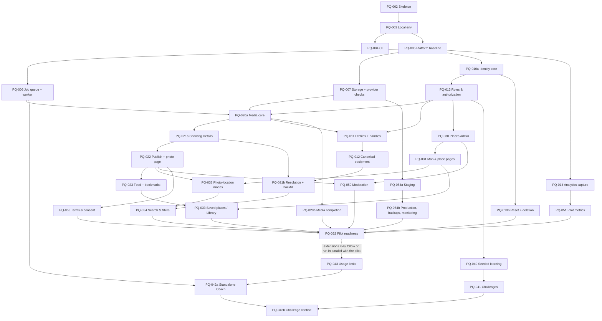

# Implementation Roadmap

- **Updated:** 2026-11-03 — vertical slices S0–S5 approved with decision record Revision 4.
- `TASKS.md` is the execution source of truth; this document explains the order, dependencies, staging rules and decision checkpoints.
- Effort is a rough relative estimate for one developer with Claude Code [A]: S ≈ days, M ≈ 1–2 weeks, L ≈ 2–4 weeks.

---

## 1. Slices

Each slice ends with a working end-to-end journey that can be demonstrated on staging before the next slice starts.

| Slice | Journey validated at the end | Tasks (in order) | Effort |
|---|---|---|---|
| **S0 Walking skeleton** | API, worker and Russian frontend shell run locally and in CI | PQ-002 → PQ-003 → PQ-004 → PQ-005 | M |
| **S1 Publish and view one photo** | Invited tester signs in, uploads a JPEG, reviews Shooting Details (raw equipment text), publishes; an anonymous staging visitor opens the photo page; privacy tests prove variants contain no metadata/GPS | PQ-006, PQ-007 → PQ-010a → PQ-013 → PQ-020a → PQ-021a → PQ-022; PQ-054a in parallel once D-11 is decided | L |
| **S2 Browse and profile** | Feed, photo bookmarks, public profiles by handle with per-field visibility | PQ-023, PQ-011 | M |
| **S3 Find a place** | Admin creates places; map/list and place pages; photos linked in exact/approximate/private mode; saved places; Library | PQ-030 → PQ-031 → PQ-032 → PQ-033 | L |
| **S4 Gear and search** | User gear; canonical/provisional resolver; backfill of earlier snapshots; search and merge-aware filters | PQ-012 → PQ-021b → PQ-034 | M |
| **S5 Safe for real people** | Reports and hide/unhide; terms and consent; password reset and account deletion; PNG/WebP, cleanup, reconciliation; analytics capture; production with tested backups and monitoring | PQ-050, PQ-053, PQ-010b, PQ-020b, PQ-014, PQ-054b | L |
| **Pilot gate** | Full E2E journeys; pilot metric queries; staging wiped; seed content in production | PQ-051 → PQ-052 | M |
| **E1 AI Coach** (extension) | Feature-flagged standalone Coach on own posts | PQ-043 → PQ-042a | M |
| **E2 Learning** (extension) | Seeded paths, private submissions, challenge-context Coach | PQ-040 → PQ-041 → PQ-042b | M–L |
| **E3 Other extensions** | Admin screens, extra filters, link previews, GPS suggestion, notifications | by pilot feedback | — |

Why this order:
- The riskiest code (media pipeline and variant privacy) runs end to end in S1, before Explore exists.
- S1 stores raw equipment text only; because original text is always preserved, S4 backfills model IDs without loss.
- Deploying staging in S1 surfaces hosting and provider problems early.
- E1 and E2 may start after the pilot gate or in parallel with the pilot; they never block it.

---

## 2. Dependency graph

**Critical path:** PQ-002 → PQ-003 → PQ-005 → PQ-006/PQ-007 → PQ-020a → PQ-021a → PQ-022 → PQ-032 → PQ-021b/PQ-034 → PQ-050/PQ-053 → PQ-052, with PQ-054a during S1 and PQ-054b before PQ-052.

---

## 3. Staging and pre-S5 testing rules

Until S5 is complete and the pilot gate passed:

**Access**
- Staging is reachable only by invited testers. Public registration is disabled; accounts are created by an admin or with single-use invite codes.
- An access gate protects the whole site (e.g. HTTP basic auth or an IP allowlist at the reverse proxy [A]), because public photo and place pages are anonymous by design.

**No search-engine indexing**
- `X-Robots-Tag: noindex, nofollow` on every response, `robots.txt` disallow-all, `<meta name="robots" content="noindex">` in the SPA shell. Verified by a test request. The access gate is the real protection.

**Separation**
- Separate database, bucket, credentials and secrets from production. No data is copied between staging and production in either direction.

**Test data and consent**
- Use photos owned by the developer, or photos whose authors gave explicit written permission for testing.
- Testers are adults known to the developer. Before access they are informed in writing: it is a test system; what is stored (account email, photos, Shooting Details, locations); who can see it (other invited testers and the operator); data may be deleted at any time and is deleted when testing ends. Their acknowledgement is recorded.
- Testers upload only their own photos, **without identifiable people** and **without locations near homes, workplaces or other private places**, preferring "approximate" or "private" modes.
- No production users, no personal data beyond the testers' own accounts, no photos of minors.
- Staging data is wiped (database and bucket) before the pilot and whenever the consent basis changes.
- The R-07 legal review applies to the pilot; data minimisation applies throughout.

**No public or wider pilot access before S5 is complete.** Moderation, terms, backups and monitoring are mandatory pilot requirements.

---

## 4. Decision checkpoints (all still open unless marked)

| Before | Decide |
|---|---|
| PQ-002 (S0) | D-17 toolchain (in the PQ-002 plan) |
| PQ-005 (S0) | D-05 OpenAPI workflow |
| PQ-007 / PQ-020a (S1) | D-03 storage provider and upload size enforcement; D-07 image library; D-08 GPS retention; upload limits (M-08) |
| PQ-010a (S1) | D-04 auth mechanism; D-16 hashing |
| PQ-054a (S1) | **D-11 hosting** (moved earlier) |
| PQ-031 (S3) | D-06 map provider |
| PQ-032 (S3) | D-20 cell sizes |
| PQ-012 (S4) | D-15 seed equipment list |
| PQ-010b (S5) | D-21 reset channel |
| PQ-014 (S5) | D-13 analytics implementation |
| PQ-020b / PQ-022 | Q-7 retention values |
| PQ-053 / PQ-054b / PQ-052 | R-07 legal review (start early) |
| PQ-043 / PQ-042a (E1) | D-14 allowance; D-02 AI provider |
| PQ-040 (E2) | D-22 learning page access |
| E3 | D-18 link previews |

Decided: D-01, D-09, D-10, D-12, D-19, D-23; D-24 superseded by the handle decision.

---

## 5. First implementation task

**PQ-002 — Create project skeleton**, starting with the D-17 proposal for approval. Implementation waits for owner approval.
